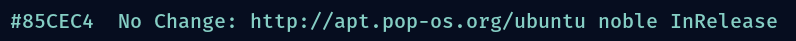
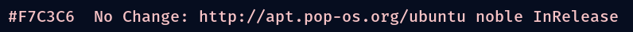
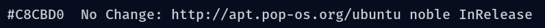

# COSMIC Terminal schemes

Colour schemes for COSMIC Terminal. The desktop `.ron` in `cosmic/` does not
colour ANSI text, so the terminal needs its own import.

1. COSMIC Terminal → **View → Color schemes…** (not Settings → Appearance)
2. **Dark** tab → **Import** → a `.ron` from this folder
3. View → Settings → Appearance → Color scheme (dark) → the scheme name

If a profile is set as default, set the scheme on that profile too or the
dropdown will look like it did nothing. `cosmic/install.sh` selects **Prism**,
so import that one at least.

Every scheme here keeps the 16 ANSI colours of Prism. Only the plain text
colour and the dim text change, so bat, lsd, starship, nala and btop look the
same whichever one you pick. The cursor stays petal  `#F7C3C6`.

The ANSI slots follow the rice: `red` is ruby  `#E95C4B`, the one colour
kept for what is wrong; `green` is azure  `#6488EA`; `yellow` is ice
 `#D5EDEB`; `blue` is the petal accent  `#F7C3C6`, so nala's `Updated:` and
`Downloaded:` labels sit in the rice's own colour next to the azure
`No Change:`; `magenta` is coral  `#FFA69E`, the warm colour numbers and
warnings take; `cyan` is haze  `#85CEC4`; `white` is
 `#E1E9F5`. Directories are not affected: `LS_COLORS` in `zsh/prism.zsh` colours
them in truecolor.

## Which one

Frost  `#E0F7FA` is the default. The others move through Prism's own greys
and tints: calmer above it, brighter below it, for whoever finds the default
glares at night or reads too dim by day.

| Scheme | Plain text | Contrast | Also used for |
|--------|------------|----------|---------------|
| Prism Haze |  `#8893B3` | 6.3:1 | muted text, the dim text colour |
| Prism Teal |  `#85CEC4` | 10.7:1 | directories (`LS_COLORS`), types |
| Prism Azure |  `#6488EA` | 5.8:1 | strings, success, the `green` slot |
| Prism Petal |  `#F7C3C6` | 12.5:1 | the accent, the cursor and the `blue` slot |
| Prism Pearl |  `#C8CBD0` | 11.9:1 | a neutral a step from plain text |
| **Prism** (default) |  `#E0F7FA` | 17.4:1 | the desktop text colour |

When plain text shares a colour with an ANSI slot, output in that slot stops
standing out: directories in Prism Teal, for example, look like plain text.
Ruby errors and coral numbers stand out more against the dimmer
schemes than against frost.

**Bold:** `bright_foreground` ( `#F6F8FF`) only colours bold text when
`use_bright_bold` is on. The baseline config in `cosmic/config/` leaves it off,
so bold text is the plain text colour at weight 800.

Previews are rendered in Fira Mono on the theme background  `#060D1F`, not
taken from the terminal. In COSMIC you get Maple Mono at 77% opacity over the
wallpaper, so text looks a little softer and contrast a little lower.

## Dark

**Prism** · `Prism-term.ron` · frost  `#E0F7FA`, 17.4:1. The default.

**Prism Haze** · `Prism-term-haze.ron` ·  `#8893B3`, 6.3:1. Muted text, the dim text colour.

**Prism Teal** · `Prism-term-teal.ron` ·  `#85CEC4`, 10.7:1. Directories (`LS_COLORS`), types.

**Prism Azure** · `Prism-term-azure.ron` ·  `#6488EA`, 5.8:1. Strings, success, the `green` slot.

**Prism Petal** · `Prism-term-petal.ron` ·  `#F7C3C6`, 12.5:1. The accent, the cursor and the `blue` slot.

**Prism Pearl** · `Prism-term-pearl.ron` ·  `#C8CBD0`, 11.9:1. A neutral a step from plain text.

Contrast is plain text on the theme background, WCAG 2.
